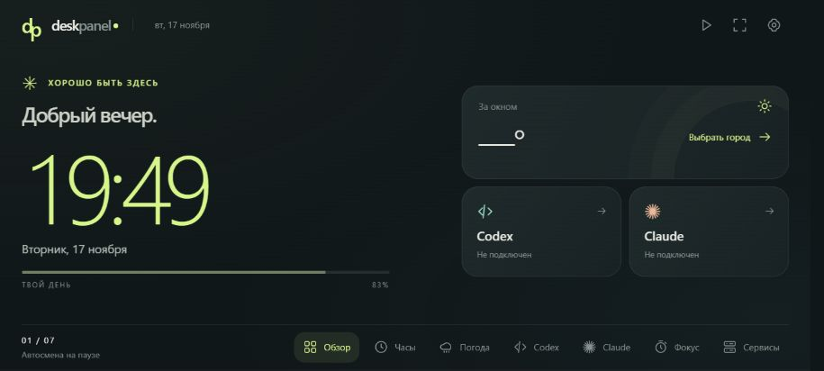
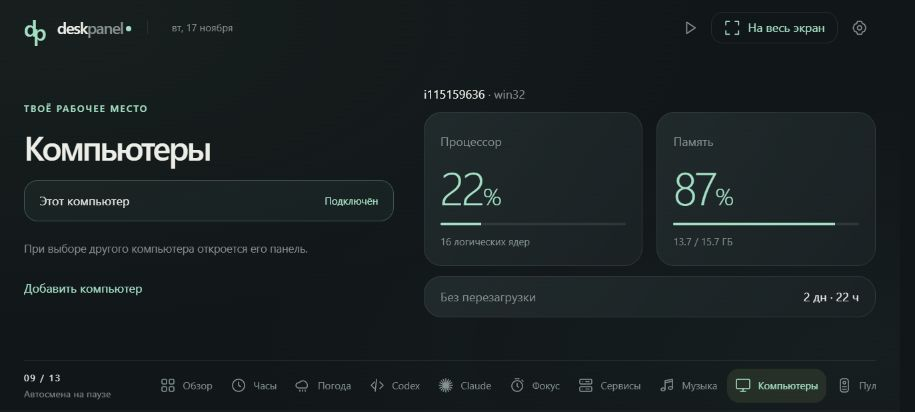
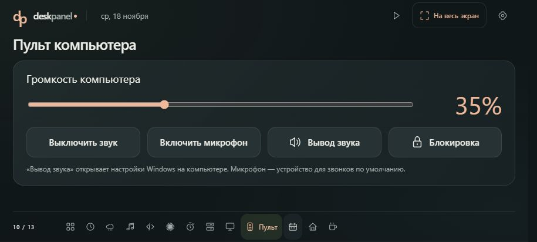
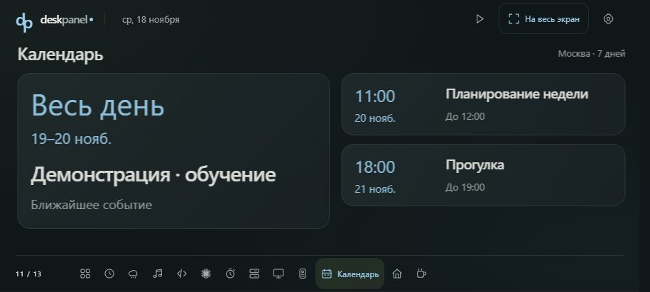
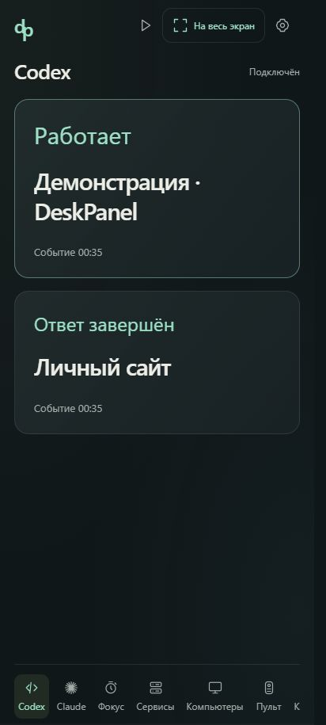

# DeskPanel

Локальная панель для телефона на подставке: несколько экранов, автоматическая смена и свайпы. Интерфейс на русском, без этапа сборки. Сервер использует node-ical для календаря.



## Что уже работает

- Одиннадцать экранов: обзор, погода, музыка, Codex, Claude, таймеры, сервисы, компьютеры, пульт, календарь и дом. Таймер, фокус и перерывы собраны во вкладках одного экрана; часы находятся на обзоре. Экран начала встречи открывается по событию и из календаря.
- Компьютеры: реальная загрузка CPU, память, время работы и сохранённые ссылки на панели других устройств.
- Пульт Windows: системная громкость, отключение звука и микрофона, открытие настроек аудиовыхода, блокировка с подтверждением.
- Перерывы: рабочий интервал и отдых (по умолчанию 50 / 5 минут), пауза, сохранение и напоминание на других экранах.
- Подключаемые адаптеры календаря ICS, Яндекс / Алиса и Home Assistant. Нужны собственные ссылка и токен; без них показывается состояние «Не подключено».
- Автоматическое перелистывание, по умолчанию каждые 20 секунд.
- Пауза после касания или свайпа, по умолчанию 30 секунд, затем полный интервал просмотра.
- Свайпы влево/вправо, нижняя навигация и стрелки клавиатуры. Пробел включает/выключает автосмену.
- Настройка порядка и видимости экранов. Последний экран отключить нельзя.
- Настройки сохраняются локально в браузере.
- Часы, дата, секунды по желанию и ночное приглушение.
- Фокус-таймер на 15, 25, 45 или 60 минут. Продолжает идти при переключении экранов и после перезагрузки страницы.
- Погода через сервер: MET Norway, резервный Open-Meteo, кеш и сохранённый прогноз при сбоях. По умолчанию — Москва.
- Полноэкранный режим и удержание экрана, если это поддерживает браузер.

**Codex:** подключены живые статусы из локальных метаданных приложения и мост событий hooks. На панель передаются только название чата, хешированные идентификаторы, статус и время. Ожидание ответа определяется по ID вызова вопроса и ID в служебном ответе; тексты вопросов и ответов не сохраняются и не передаются. На других экранах появляется плашка «Codex ждёт ответа». Установка и проверка доверия описаны в [инструкции](docs/codex.md). Claude пока не подключён. Экран сервисов показывает фактические состояния подключений.

Экраны пересобраны для телефона: крупные данные и основные действия, без декоративных блоков. Календарь выделяет ближайшее событие и корректно показывает многодневные события на весь день. Умный дом разделён по домам и комнатам; датчики отдельно от управления.

## Обзор и умные переходы

Обзор показывает часы, дату и погоду строкой, одну карточку по контексту и компактный музыкальный пульт только во время воспроизведения. Приоритет карточки: встреча за 5 минут до начала, вопрос/разрешение агента, запущенный таймер, ближайшее событие календаря. Если событий нет, часы занимают больше места.

Умные переходы включены в настройках: встреча за 5 минут до начала (до 2 минут после старта), вопрос агента — один переход на событие. Экран удерживается минимум 20 секунд. Касание, свайп, открытые настройки и подтверждение команды откладывают переход. Кнопка паузы автосмены останавливает и умные переходы. Свайпы работают всегда.

Быстрые таймеры: 1, 5, 10, 15, 30 минут и свой интервал до суток. Состояние сохраняется после обновления; по окончании — «Закрыть» / «Ещё 5 минут». В этом же экране вкладки «Фокус» (15/25/45/60 минут) и «Перерывы» (цикл работы и отдыха). Рабочие отсчёты и настройки сохраняются при переключении вкладок.

Вечерний режим включён с 22:00 до 07:00 по времени телефона: приглушение, переход к спокойному обзору один раз, без автосмены и рабочих уведомлений. После ручного выбора экран остаётся выбранным; таймер, запущенный вручную, уведомляет и вечером. Часы расписания и сам режим меняются в настройках. Уведомления работают, пока браузер выполняет страницу; после сна таймер проверяется при возвращении.

[Подробности погоды, встреч и поведения](docs/context.md).

## Запуск на компьютере

Нужен Node.js 22.13 или новее. При первом запуске установи зависимости:

```sh
npm ci --ignore-scripts
npm start
```

Открыть http://localhost:4317. На Windows также можно запустить **Start-DeskPanel.cmd**.

## Запуск для телефона

Телефон и компьютер должны находиться в одной домашней сети.

```sh
npm run start:phone
```

Или **Start-Phone.cmd** на Windows. Открой на телефоне адрес из строки `Phone:`, например `http://192.168.1.10:4317`.

- Компьютер должен оставаться включенным.
- При необходимости разреши Node.js в брандмауэре **только для частной сети**.
- Для постоянного показа подойдет киоск-браузер. Обычный HTTP по локальной сети может не разрешать Screen Wake Lock — тогда удержание экрана настраивается в киоск-браузере или на телефоне.
- Порт занят: `node server/index.mjs --lan --port 4318`.
- Остановка сервера: Ctrl+C в окне запуска.

Календарь, дом, пульт и статусы агентов требуют привязки телефона по одноразовому коду. Музыкальный пульт и показатели компьютера доступны в домашней сети без привязки. Сервер предназначен для доверенной локальной сети, а не интернета. HTTP не шифрует сетевой трафик. [Подключение телефона и сервисов](docs/connections.md).

## Музыка

Пульт Яндекс Музыки RS: воспроизведение, пауза, переключение треков и запуск приложения на компьютере. Расширенная сборка добавляет фактический статус, название трека и громкость. [Подключение и устройство интеграции](docs/music.md).

## Экраны

Снимки ниже используют демонстрационные данные.




Календарь и умный дом настраиваются только через `http://localhost:4317` на том компьютере, где запущен сервер. Ссылка ICS и токен сохраняются в Windows DPAPI, не в Git или localStorage. [Пошаговая настройка](docs/connections.md).

## Управление

Верхняя панель: пауза автосмены, кнопка «На весь экран», настройки. Нажми «На весь экран», чтобы запросить скрытие панелей браузера. Вход требует нажатия; после обновления страницы может понадобиться нажать снова. Выход — той же кнопкой или системной командой назад/Esc. Доступность зависит от браузера; фактическое скрытие панелей Яндекс Браузера нужно проверить на телефоне. Нижняя панель: прямой переход к экрану. Свайп по содержимому переключает соседний экран; вертикальный жест прокручивает содержимое.

В настройках можно выбрать время показа, задержку после взаимодействия, порядок и видимость экранов, секунды, ночное приглушение и город. Город по умолчанию — Москва; старые настройки без города обновляются автоматически. Другой выбранный город сохраняется. Город можно изменить или убрать; геолокация не запрашивается. Погода загружается через сервер: основной источник MET Norway, резервный Open-Meteo; ключи API не нужны.




## Структура

```text
src/
  app.js              # оболочка, навигация, свайпы, настройки
  styles.css          # адаптивный интерфейс
  core/               # настройки, таймер автосмены, фокус-таймер
  screens/
    registry.js       # реестр экранов
    overview.js
    clock.js
    weather.js
    agent.js          # общий экран для Codex и Claude
    focus.js
    services.js
  data/               # источники погоды и статуса агентов
  ui/                 # иконки и базовые стили
server/
  index.mjs           # локальный HTTP-сервер
  bridge.mjs          # единый контракт статусов
  adapters/
    codex.mjs         # заглушка для следующего этапа
    claude.mjs        # статусы Claude Code из hooks (см. docs/claude.md)
tests/                # поведенческие тесты без дополнительных пакетов
docs/
  architecture.md     # контракт модулей и границы этапов
```

## Проверки

```sh
npm run check
npm test
```

Тесты проверяют автосмену и паузы, распознавание свайпов, сохранение настроек, таймер между перезагрузками, статусы неподключенных адаптеров и запрет отдачи серверных/служебных файлов.

## Обмен версиями между компьютерами

[Получение обновлений через Git и подключение Claude на втором компьютере](docs/multi-computer.md). Настройки сервисов и привязки остаются локальными.

## Следующий этап

Codex показывает группы чатов, счётчики и время в статусе; ожидание ответа проверено на телефоне. Ожидание разрешения поддерживается через hooks, но живые события установленного Desktop пока не поступают. Claude подключается отдельно на другом компьютере через общий контракт. Совместимость Codex Desktop, Codex CLI и Claude Code проверяется отдельно; наличие процесса не считается доказательством выполнения задачи.

## Автозапуск и восстановление

`Enable-Autostart.cmd` включает скрытый запуск сервера при входе в Windows и перезапуск после сбоя. Открытая панель показывает потерю связи и обновляет данные после возвращения компьютера или Wi-Fi. [Установка, управление и ограничения](docs/reliability.md).
