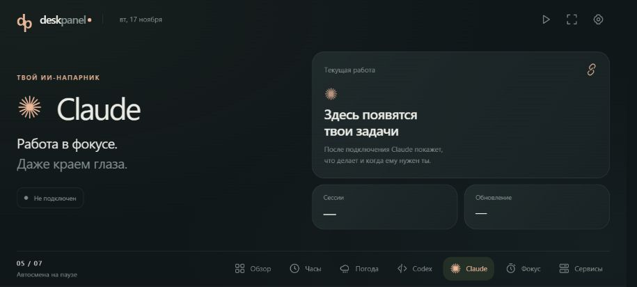
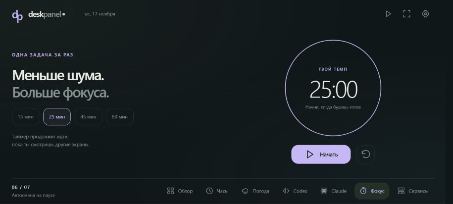

# DeskPanel

Локальная панель для телефона на подставке: несколько экранов, автоматическая смена и свайпы. Интерфейс на русском, без сборки и внешних библиотек.


## Что уже работает

- Восемь экранов: обзор, часы, погода, музыка, Codex, Claude, фокус-таймер и сервисы.
- Автоматическое перелистывание, по умолчанию каждые 20 секунд.
- Пауза после касания или свайпа, по умолчанию 30 секунд, затем полный интервал просмотра.
- Свайпы влево/вправо, нижняя навигация и стрелки клавиатуры. Пробел включает/выключает автосмену.
- Настройка порядка и видимости экранов. Последний экран отключить нельзя.
- Настройки сохраняются локально в браузере.
- Часы, дата, секунды по желанию и ночное приглушение.
- Фокус-таймер на 15, 25, 45 или 60 минут. Продолжает идти при переключении экранов и после перезагрузки страницы.
- Погода Open-Meteo, по умолчанию для Москвы: текущие условия и пять дней прогноза.
- Полноэкранный режим и удержание экрана, если это поддерживает браузер.

**Codex, Claude и сервисы пока не подключены.** Это намеренный первый этап: структура и интерфейс. Адаптеры возвращают `not_configured`, а экран честно показывает «Не подключен». Приложение не читает чаты, логи, ключи или настройки агентов.

## Запуск на компьютере

Нужен Node.js 20 или новее. Установка npm-зависимостей не нужна.

```sh
npm start
```

Открыть http://localhost:4317. На Windows также можно запустить **Start-DeskPanel.cmd**.

## Запуск для телефона

Телефон и компьютер должны находиться в одной домашней сети.

```sh
npm run start:phone
```

Или **Start-Phone.cmd** на Windows. Открой на телефоне адрес из строки `Phone:`, например `http://192.168.1.10:4317`.

- Компьютер должен оставаться включенным.
- При необходимости разреши Node.js в брандмауэре **только для частной сети**.
- Для постоянного показа подойдет киоск-браузер. Обычный HTTP по локальной сети может не разрешать Screen Wake Lock — тогда удержание экрана настраивается в киоск-браузере или на телефоне.
- Порт занят: `node server/index.mjs --lan --port 4318`.
- Остановка сервера: Ctrl+C в окне запуска.

Этот локальный сервер не имеет авторизации и не предназначен для публикации в интернете. До подключения реальных данных агентов потребуется отдельно спроектировать доступ с телефона.

## Музыка

Пульт Яндекс Музыки RS: воспроизведение, пауза, переключение треков и запуск приложения на компьютере. Расширенная сборка добавляет фактический статус, название трека и громкость. [Подключение и устройство интеграции](docs/music.md).

## Управление

Верхняя панель: пауза автосмены, кнопка «На весь экран», настройки. Нажми «На весь экран», чтобы запросить скрытие панелей браузера. Вход требует нажатия; после обновления страницы может понадобиться нажать снова. Выход — той же кнопкой или системной командой назад/Esc. Доступность зависит от браузера; фактическое скрытие панелей Яндекс Браузера нужно проверить на телефоне. Нижняя панель: прямой переход к экрану. Свайп по содержимому переключает соседний экран; вертикальный жест прокручивает содержимое.

В настройках можно выбрать время показа, задержку после взаимодействия, порядок и видимость экранов, секунды, ночное приглушение и город. Город по умолчанию — Москва; старые настройки без города обновляются автоматически. Другой выбранный город сохраняется. Город можно изменить или убрать; геолокация не запрашивается. При поиске города и загрузке погоды браузер обращается к Open-Meteo.




## Структура

```text
src/
  app.js              # оболочка, навигация, свайпы, настройки
  styles.css          # адаптивный интерфейс
  core/               # настройки, таймер автосмены, фокус-таймер
  screens/
    registry.js       # реестр экранов
    overview.js
    clock.js
    weather.js
    agent.js          # общий экран для Codex и Claude
    focus.js
    services.js
  data/               # источники погоды и статуса агентов
  ui/                 # иконки и базовые стили
server/
  index.mjs           # локальный HTTP-сервер
  bridge.mjs          # единый контракт статусов
  adapters/
    codex.mjs         # заглушка для следующего этапа
    claude.mjs        # заглушка для следующего этапа
tests/                # поведенческие тесты без дополнительных пакетов
docs/
  architecture.md     # контракт модулей и границы этапов
```

## Проверки

```sh
npm run check
npm test
```

Тесты проверяют автосмену и паузы, распознавание свайпов, сохранение настроек, таймер между перезагрузками, статусы неподключенных адаптеров и запрет отдачи серверных/служебных файлов.

## Следующий этап

Подключить Codex и Claude к существующему контракту, затем отладить состояния «работает», «ждет ответа», «завершено», «ошибка», восстановление связи и устаревание данных. Совместимость Codex Desktop, Codex CLI и Claude Code проверяется отдельно; наличие процесса не считается доказательством выполнения задачи.
